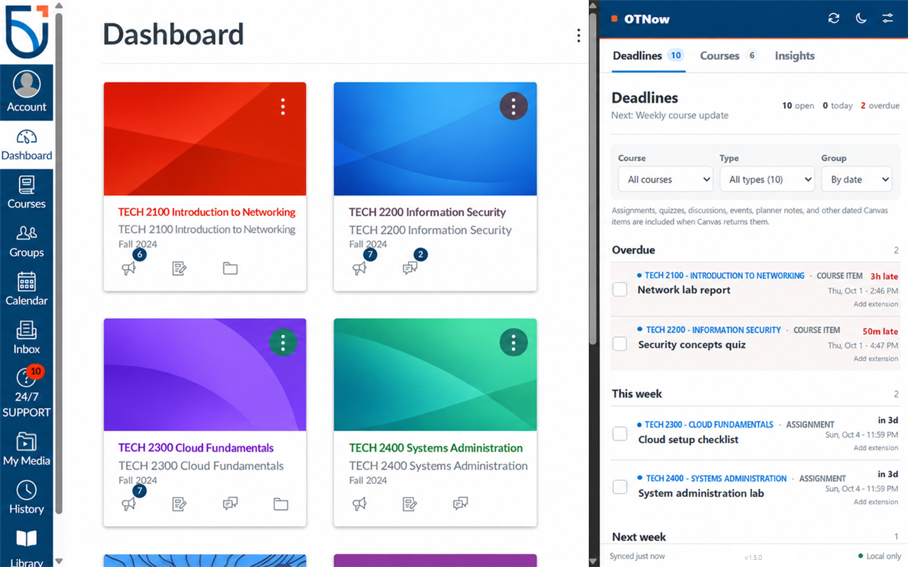
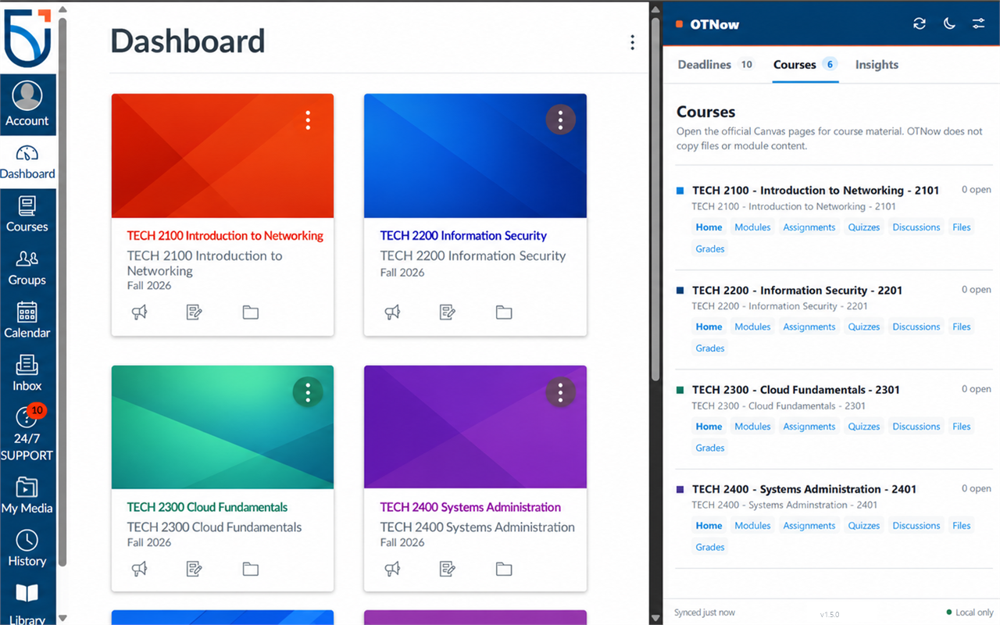
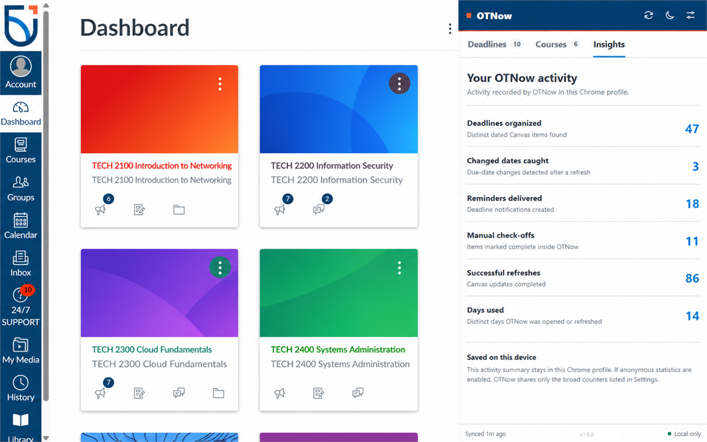
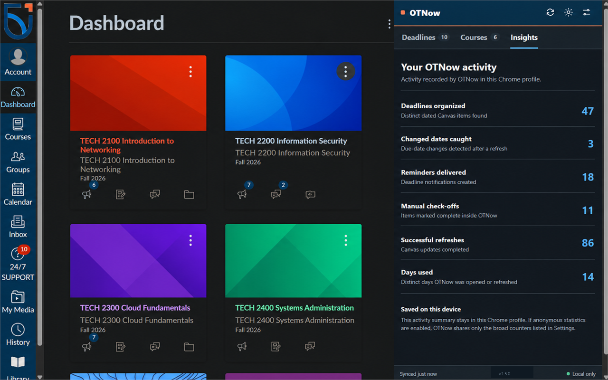

<div align="center">
  
  <h1>OTNow</h1>
  <p><strong>Your Ontario Tech Canvas deadlines, organized in one browser sidebar.</strong></p>
  <p>OTNow is an unofficial, private-by-default extension that finds dated coursework, notices moved due dates, and sends configurable reminders without asking for your Canvas password.</p>

  <p>
    <a href="https://chromewebstore.google.com/detail/otnow/ekaachncjiajgiikgikhpafcnepompkn"></a>
    <a href="docs/FIREFOX_RELEASE.md"></a>
    <a href="https://ko-fi.com/sil6428"></a>
  </p>

  <p>
    <a href="https://otnow-stats.sil6428-archtech.workers.dev/">Website</a> ·
    <a href="https://otnow-stats.sil6428-archtech.workers.dev/dashboard">Live statistics</a> ·
    <a href="https://otnow-stats.sil6428-archtech.workers.dev/privacy">Privacy</a> ·
    <a href="https://docs.google.com/forms/d/e/1FAIpQLSfvZY5paIPzJv8adIeHdkpgwzXldEqnMhM4Zbp2_c8kg7dqXw/viewform">Feedback</a>
  </p>
</div>


## What you get

- **One deadline list.** Assignments, quizzes, discussions, announcements, events, planner notes, and other dated Canvas items appear together.
- **Useful organization.** Filter by course or type, search by name, and group work by date or item type.
- **Changed-date detection.** When Canvas moves a due date, OTNow highlights the change for seven days and can notify you.
- **Flexible reminders.** Choose different reminder timing for assignments, quizzes, discussions, events, and planner notes, or mute one course without hiding it.
- **Clear completion history.** Completed work has its own organized view, and local check-offs can be restored without changing Canvas.
- **Offline resilience.** If Canvas or the network is unavailable, OTNow keeps showing the most recent successful read and tries again later.

OTNow also includes direct course links, local approved-extension dates, automatic light/dark appearance, a private activity summary, and optional anonymous aggregate statistics.

<details>
<summary><strong>See the full feature list</strong></summary>

- Reads active courses and dated Canvas planner items every 30 minutes while the browser is running.
- Groups deadlines into useful date ranges or by item type.
- Keeps announcement read status locally, supports course-aware bulk marking, and can undo the latest bulk action.
- Links directly to each course's home, modules, assignments, quizzes, discussions, files, and grades.
- Distinguishes Canvas completion from an OTNow check-off.
- Applies a student-entered extension date locally and restores the original Canvas date with one action.
- Tracks local totals for organized deadlines, moved dates, reminders, and manual check-offs.
- Shows a short, dismissible summary after an update with a link to the complete changelog.
- Lets students opt into or out of anonymous numerical statistics at any time.
- Updates automatically when installed from an official browser store.

</details>

## What it looks like

| Deadlines | Courses |
| --- | --- |
|  |  |
| **Insights** | **Dark appearance** |
|  |  |

Screenshots use sanitized Canvas information and contain no real grades, student identifiers, or private coursework.

## Install

### Chrome and Chromium browsers

**[Install OTNow from the Chrome Web Store](https://chromewebstore.google.com/detail/otnow/ekaachncjiajgiikgikhpafcnepompkn).** This is the recommended option for Chrome, Brave, Edge, and other Chromium-based browsers because the browser handles installation and updates.

After installing, sign in to [Ontario Tech Canvas](https://learn.ontariotechu.ca/), pin OTNow, and select its toolbar icon. If Canvas was already open during installation, reload that tab once.

### Firefox

An initial OTNow 1.6.0 package was submitted to Mozilla Add-ons on October 14, 2026. The corrected 1.6.1 candidate includes the final notification-sync fix and supersedes that package. The Firefox build uses the same feature source as Chrome and Firefox's native sidebar. A public install link will be added only after Mozilla publishes the signed build and it passes a final installation test.

Follow progress in the [Firefox release record](docs/FIREFOX_RELEASE.md).

<details>
<summary><strong>Manual installation from GitHub</strong></summary>

Most students should use a browser store. The packaged GitHub release is available for development and transparent manual installation:

1. Open the [latest OTNow release](https://github.com/sil6428/OTNow/releases/latest).
2. Under **Assets**, download `otnow-VERSION.zip`. Do not use GitHub's green **Code → Download ZIP** button.
3. Extract the ZIP and open the folder where `manifest.json` is directly visible.
4. Open `chrome://extensions`, enable **Developer mode**, and select **Load unpacked**.
5. Choose the folder that directly contains `manifest.json`.

See the [beginner installation guide](INSTALL.md) and [manual update guide](UPDATE_GUIDE.md) for complete instructions.

</details>

## Privacy by default

OTNow uses the Ontario Tech Canvas session already open in your browser. It never asks for, receives, or stores your password.

- Canvas access is restricted to read-only course and planner requests.
- Course names, coursework, due dates, settings, reminders, and check-offs stay in extension storage on your computer.
- There is no OTNow account, advertising code, analytics SDK, or behavioural tracker.
- Anonymous global statistics are **off by default**. Nothing is transmitted unless the student explicitly enables them.
- Optional reports contain only a random installation ID, version, numerical totals, and an optional 1–5 rating—never names, courses, coursework titles, grades, emails, student numbers, Canvas IDs, or URLs.
- Opting out requests deletion of that installation's aggregate row and removes its reporting ID locally.

The Chrome Web Store package has no GitHub host permission because Chrome manages its updates. Manually installed Chrome copies read only OTNow's public manifest periodically to check for a newer version. Firefox uses Mozilla-managed updates.

Read the [public privacy policy](https://otnow-stats.sil6428-archtech.workers.dev/privacy), its [repository copy](PRIVACY.md), or the detailed [permission explanations](docs/PERMISSION_JUSTIFICATIONS.md).

## How it works

```text
Signed-in Canvas tab
        ↓ read-only requests
Canvas courses + planner items
        ↓ normalize and compare
Local browser storage
        ↓
Sidebar, reminders, changed dates, and Insights
```

OTNow allows only these Canvas API reads:

- `GET /api/v1/courses`
- `GET /api/v1/planner/items`

The extension keeps the last successful result so a temporary Canvas or network failure does not empty the sidebar. Notification failures are isolated from syncing, so they cannot turn a successful Canvas refresh into a stale-data warning.

## Support the project

OTNow is maintained independently and does not charge students. If it has helped you, you can **[support OTNow on Ko-fi](https://ko-fi.com/sil6428)**. Donations are optional and never unlock features or change how the extension works.

- [Report a bug or suggest an improvement](https://docs.google.com/forms/d/e/1FAIpQLSfvZY5paIPzJv8adIeHdkpgwzXldEqnMhM4Zbp2_c8kg7dqXw/viewform)
- [Report a security issue privately](https://github.com/sil6428/OTNow/security/advisories/new)
- [View the public opt-in statistics dashboard](https://otnow-stats.sil6428-archtech.workers.dev/dashboard)

Please remove student numbers, grades, private course content, session details, and other personal information from feedback. Security vulnerabilities should follow [SECURITY.md](SECURITY.md), not the general feedback form.

## Development

OTNow has no runtime dependencies or extension build step: the repository source is the extension package. Packaging scripts create browser-specific store ZIPs from that shared source.

```bash
npm test
npm run check
npm run check:firefox
npm run smoke:extension
```

```powershell
npm run package:store
npm run package:firefox
npm run package:firefox-source
npm run package:release
```

### Repository map

| Path | Purpose |
| --- | --- |
| `src/background.js` | Canvas syncing, reminders, changed dates, badges, and messages |
| `src/canvas-client.js` | Allowlisted Canvas reads and pagination |
| `src/canvas-model.js` | Canvas data normalization and due-date reconciliation |
| `src/global-stats.js` | Strict opt-in anonymous report and deletion flow |
| `src/metrics.js` | Private on-device activity counters and migrations |
| `panel/` | Chrome side panel and Firefox sidebar interface |
| `options/` | Reminder, appearance, privacy, and consent screens |
| `stats-worker/` | Public website, aggregate dashboard, privacy page, and D1 service |
| `scripts/` | Validation and browser-specific packaging |
| `tests/` | Unit and integration tests using representative Canvas response shapes |

Pushing a tag that matches both browser manifest versions, such as `v1.6.1`, validates the shared code, creates the Chrome, Firefox, and manual-release packages, writes SHA-256 checksums, and publishes the GitHub release.

### Project documentation

| Document | Contents |
| --- | --- |
| [Changelog](CHANGELOG.md) | User-facing release history |
| [1.6 release plan](docs/RELEASE_1_6_PLAN.md) | Scope, acceptance criteria, and remaining checks |
| [Release checklist](docs/RELEASE_CHECKLIST.md) | Packaging and publication gates |
| [Chrome submission guide](docs/CHROME_WEB_STORE_SUBMISSION.md) | Chrome Web Store release process |
| [Firefox release record](docs/FIREFOX_RELEASE.md) | Firefox validation and Mozilla submission status |
| [Metrics guide](docs/METRICS.md) | Responsible measurement and public wording |

## Status and attribution

GitHub provides the transparent manual OTNow 1.6.1 release. The Chrome Web Store continues to serve 1.5.0 until the public Canvas-item milestone reaches 1,000 or Mozilla approves the corrected Firefox package. Firefox should not be described as available until its signed listing is live and passes a final installation test.

OTNow is not affiliated with or endorsed by Ontario Tech University or Instructure. The product direction was inspired in part by [WATnow](https://github.com/EricJujianZou/watnow), an MIT-licensed deadline-panel project for Brightspace schools.

Released under the [MIT License](LICENSE). Third-party notices are listed in [THIRD_PARTY_NOTICES.md](THIRD_PARTY_NOTICES.md).
